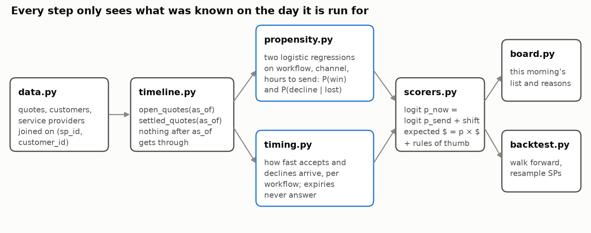

# How it works, in a bit more detail

The README covers what the tool does and how well it works. This page explains the choices behind
it, in plain terms. The notebooks show every step with its numbers, if you want to see the working.

## Picking the problem

I started by asking which outcomes in the data actually change with things we know in advance,
because only those can be predicted ([notebook 2](notebooks/02_where_the_signal_is.ipynb)).

| Idea | How often it happens | Does it change with what we know in advance? |
|---|---|---|
| Invoices that never get paid | 24% | Barely: between 21% and 26% however I split it |
| Visits that get cancelled | 10% | Only with rescheduling, which comes too late to act on |
| Businesses leaving Jobber | 30 of 500 | Too rare to learn from |
| **Quotes being accepted** | **67%** | **Yes: from 55% to 79% depending on the type of work** |

Unpaid invoices were my first choice, since getting paid matters so much to an owner. But there was
nothing in the data to predict them with, so I moved on to quotes. I also checked whether some
businesses simply win more than others. They don't, beyond what their mix of work and customers
explains, so one shared model serves all 500.

## Making sure the data is right

Before trusting any number, I run 86 checks ([notebook 1](notebooks/01_reading_the_data.ipynb)), and
all of them pass:

- every file is identical, byte for byte, to the copy in the supplied `data.zip`;
- every value reads as the type the data dictionary says it should be, with nothing missing where it shouldn't be;
- every record points to something real inside the same business;
- my daily counts of quotes created, sent and accepted match the platform's own daily figures exactly.

Two things I learned along the way shaped the design. The 1,444 quotes still marked "open" had all
expired weeks before the data was pulled, so I treat them as an export glitch and leave them out.
And the quoted amount is a fair measure of what a win is worth: the jobs that follow are planned and
invoiced within a few percent of the quote.

## How the model works

A quote ends one of three ways: a yes, a no, or no reply until it expires. The model learns three
things from past quotes:

1. **How likely a yes is** when the quote goes out, based on the type of work, how the customer
   found the business, and how quickly the quote was sent.
2. **If the answer is no, how likely the customer is to say so** rather than go quiet, from the same
   three facts.
3. **How quickly yeses and nos usually arrive**, for each type of work.

Each morning it combines them. The longer a quote waits without a reply, the more it looks like one
that will end in silence, so its chance comes down. It comes down faster for customers who tend to
go quiet, like marketplace leads, and slower for those who tend to say no out loud, like repeat and
referred customers. Statisticians call this a mixture model for competing outcomes (Larson and Dinse
1985). The formula is in [notebook 3](notebooks/03_hypotheses.ipynb).

The model is deliberately simple: each fact adds or takes away a fixed amount, so every number on
the list can be broken down into its reasons, exactly.

## Keeping the test fair

A model that has seen the answers will always look good, so I was strict about what it could see:

- **It never sees the future.** Every step is tied to a date and only uses what was known by then.
  It only learns from quotes at least 45 days old, so their endings are settled. An automated test
  proves this by rewriting every outcome after the date and checking that nothing changes.
- **Every choice was made on earlier months.** I chose the model's ingredients using practice runs
  from April to July ([notebook 4](notebooks/04_choosing_the_method.ipynb)), so September to
  December stayed untouched for the final test.
- **The test replays real mornings.** For each morning from September to December, each way of
  ordering picks a quote to call, and I check what really happened
  ([notebook 5](notebooks/05_testing_the_hypotheses.ipynb)).
- **I measure total dollars won.** That's what an owner banks. Averaging each morning's share would
  count a $60 morning the same as a $6,000 one, and on that average the list actually trails "newest
  first". Notebook 5 shows both.
- **I check how sure I can be.** Each comparison is re-run a thousand times on reshuffled sets of
  businesses. A difference only counts if the whole range of results stays on one side of zero.
- **I check the chances group by group.** Being right on average can hide being too high for one
  kind of quote and too low for another, so I compare predicted and real yes rates in 101 groups of
  similar quotes.

## What I tried and kept

Practice runs from April to July, scored on quotes the model hadn't seen:

| Which facts to use | Score (lower is better) |
|---|---|
| **Type of work, customer source, sending speed** | **0.614** |
| ...plus industry, customer type, quote size and number of items | 0.615 |
| ...plus the business's or the customer's past win rate | 0.614 to 0.616 |
| Gradient boosting with every fact | 0.709 |
| Gradient boosting with the same three facts, shallow and regularised | 0.613 (a tie) |

A carefully held-back boosting model matches the scorecard but doesn't beat it, so I kept the scorecard:
same accuracy, and every number on the list breaks down exactly into its reasons.

| How to use "days without a reply" | Score | Groups it gets wrong |
|---|---|---|
| **"Says no or goes quiet" learned for each customer** | **0.5705** | **1** |
| One figure for each type of work | 0.5717 | 3 |
| Days waiting added as one more fact | 0.5733 | 4 |
| Days waiting alone | 0.5920 | 27 |

## How the code is organised

Each file has one job, so a change in one place doesn't ripple through the rest:

| File | What it does |
|---|---|
| `data.py` | reads the files, strictly, and joins them within each business |
| `audit.py` | runs the 86 checks on the data |
| `timeline.py` | gives every other part only what was known on a given date |
| `propensity.py` | the simple, explainable scoring model |
| `timing.py` | how fast replies come, and what silence means |
| `scorers.py` | our list and every rival it's compared with, all used the same way |
| `board.py` | the list an owner reads, and the reasons behind each number |
| `backtest.py` | the replay of past mornings, and every score that comes out of it |
| `artifacts.py` | saving a fitted model with a plain summary of what it learned |

The notebooks and the scripts in `scripts/` don't hold any logic of their own. They call these files,
so the numbers in a notebook, a chart and the README always come from the same code. Every setting
lives in `config.toml`, every random step is seeded, and `make all` (or `docker compose up`) rebuilds
everything from `data.zip`.

## References

- Field, C. A. and Welsh, A. H. (2007). Bootstrapping clustered data. *Journal of the Royal Statistical Society B* 69(3).
- Larson, M. G. and Dinse, G. E. (1985). A mixture model for the regression analysis of competing risks data. *Applied Statistics* 34(3).
- Tashman, L. J. (2000). Out-of-sample tests of forecasting accuracy: an analysis and review. *International Journal of Forecasting* 16(4).
- van Houwelingen, H. C. (2007). Dynamic prediction by landmarking in event history analysis. *Scandinavian Journal of Statistics* 34(1).
