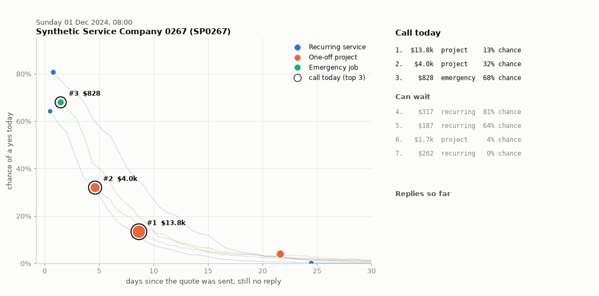
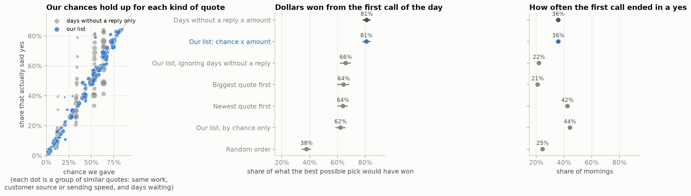

# Which quote should I call first?

Every morning, this tool looks at a home-service business's quotes that are still waiting for a
reply and ranks them, so the owner knows which call is worth making first, and why.



*Three weeks at one business, replayed every four hours. Each dot is a waiting quote: further right
means it has waited longer, higher means a better chance of a yes, bigger means more money. The
ringed dots are today's top three calls.*

## In short

- **The problem.** A third of quotes end in a no or in silence ($14.4M of work in this data), and
  the window is short. Two in three quotes end in a yes, but only one in two of those still quiet
  after 3 days, and fewer than one in four after a week.
- **What the tool does.** It gives each waiting quote its chance of a yes today, multiplies that by
  the amount, and puts the biggest expected win at the top, with a plain reason.
- **Does it work?** Replaying four months the model never saw, calling its top pick first won 81% of
  the dollars that were available, against 64% for calling the newest or the biggest quote first.

## A morning at one business

Here is the list at 8am on 12 December 2024, for business SP0267:

| Quote | Work | Amount | Waiting | Chance of a yes | Worth today | Why |
|---|---|---|---|---|---|---|
| QU013118 | emergency job | $1,738 | 1.8 days | 84% | $1,452 | helps: emergency job, referred by someone; hurts: no reply for 1.8 days |
| QU013170 | one-off project | $2,769 | 0.8 days | 45% | $1,251 | hurts: one-off project, took 2.1 days to send, found you on their own |
| QU013126 | one-off project | $13,828 | 19.7 days | 3% | $365 | hurts: no reply for 19.7 days, one-off project, came from a paid ad |

The first two said yes within a day and a half. Calling the biggest quote first would have meant the
$13.8k one, which expired. Calling the newest first would have meant a $168 quote, which expired too.
I chose this morning because the approaches disagree on it; the fair comparison is below.

## How it decides

The chance of a yes comes from patterns learned from past quotes:

- **Type of work.** Emergency jobs and recurring services are accepted far more often than one-off projects.
- **How the customer found the business.** Repeat and referred customers say yes more often.
- **How quickly the quote went out.** Quotes sent within a few hours do better.
- **How long it has waited, and for whom.** Repeat and referred customers who mean no usually say so,
  while marketplace leads just stop replying. So a quiet week from a repeat customer is far less
  worrying than the same week from a marketplace lead.

Every number on the list can be traced back to these four facts. [DESIGN.md](DESIGN.md) has the
technical detail.

## Does it work?

I replayed every morning from September to December 2024 (19,921 mornings, 493 businesses) and
compared the quote each approach would have called first with what really happened.

| How the first call is chosen | Share of available dollars won | First call said yes |
|---|---|---|
| **Our list** | **81%** | 36% |
| Simple version: days waiting × amount | 81% | 36% |
| Newest quote first | 64% | 42% |
| Biggest quote first | 64% | 21% |
| Random | 38% | 25% |

- **Our list wins 16 to 17 points more of the dollars** than either rule of thumb, and comes out
  ahead in every month.
- **It goes after bigger quotes**, so fewer first calls end in a yes. An owner who would rather count
  yeses can rank by chance instead.
- **A simpler list ranks just as well.** Days waiting times amount picks the same kind of quote first.
  The full model earns its place by getting each quote's chance right: across 101 groups of similar
  quotes it is off by more than chance in 3, against 39 for the simple version.



The data was checked before any of this: all 86 checks pass, from every file matching `data.zip`
byte for byte to the quote counts matching Jobber's own daily figures exactly.

## What it can't tell you

- **Whether a call changes the outcome.** The data has no record of follow-up calls, so some of
  these yeses would have come anyway. Skipping follow-ups on a random share of quotes for a few weeks
  would answer it.
- **Close calls.** When two quotes have nearly the same chance, which one comes through is close to
  a coin toss.
- **Some repeat customers.** Their recurring quotes are still rated too low after a few quiet days.
- **Real-world results.** The data is synthetic.

## Run it

With `data.zip` in the folder above this one:

```bash
docker compose up
```

JupyterLab opens at <http://localhost:8888/lab?token=quotes> with the notebooks ready to run. A second
service rebuilds every number, chart, model and notebook once, then stops.

Without Docker, using Python 3.12 and [uv](https://docs.astral.sh/uv/):

```bash
make setup && make data
.venv/bin/quote-followup board --sp SP0267 --as-of 2024-12-12
make all
```

The notebooks walk through the work in order:
[1 the data](notebooks/01_reading_the_data.ipynb) ·
[2 the problem](notebooks/02_where_the_signal_is.ipynb) ·
[3 what I tested](notebooks/03_hypotheses.ipynb) ·
[4 building the model](notebooks/04_choosing_the_method.ipynb) ·
[5 did it work](notebooks/05_testing_the_hypotheses.ipynb) ·
[6 the owner's view](notebooks/06_the_solution.ipynb)

## What I'd do next

- **Track every run in MLflow.** Results already reproduce exactly, because every setting sits in
  `config.toml` and every random step is seeded. For future rounds of modelling and reporting I would
  log each run in MLflow, an experiment tracker: the settings, the seeds, a fingerprint of the data,
  every number and chart, and the model itself. Any figure in a report then traces back to the run
  that made it, and a new model can be compared with the last one side by side.
- **Run the follow-up experiment** above, to learn what a call actually changes.
- **Fix the underrated repeat customers.**
- **Draft the follow-up message** for each quote on the list.

## Other patterns I noticed but didn't chase

These could each be a project of their own. I didn't dig into them, to keep this one within its
scope and time, so treat them as leads rather than findings:

- 1,863 accepted quotes ($2.3M) never became a job.
- 1,991 completed jobs ($2.6M of planned work) were never invoiced.
- All 3,517 overdue invoices ($3.6M) have received no payment at all, not even a partial one.
- Failed payments happen only through Jobber Payments: about a quarter of attempts, with bank
  transfers failing nearly twice as often as cards. Every one of those invoices was paid later.
- Visits get shakier the more they're moved: one in ten is cancelled overall, one in five after three reschedules.
- Quotes sent per month tripled during 2024 (979 in January, 2,958 in December), so any model here
  needs regular refreshing.
- All 30 businesses that cancelled their subscription kept using the product afterwards.
- Declines split almost evenly between price, timing, competitors, no response and changed scope,
  and 31% give no reason at all.

## Time

About two hours, including a full second review. 21 automated tests guard the main rules, including
one that proves the model never sees the future.
